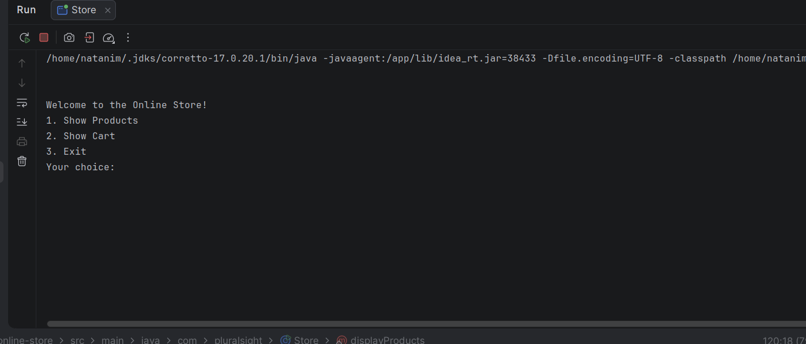
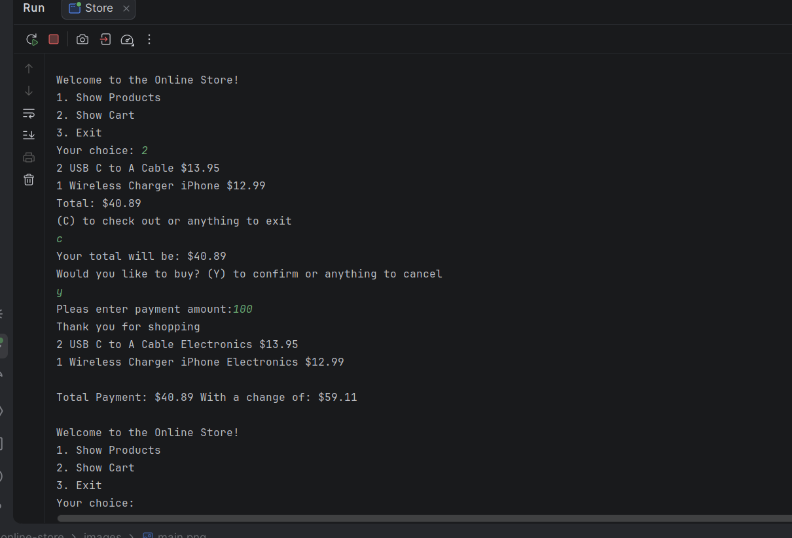

# Project Title

A Java console application that allows customers to browse products, manage a shopping cart, and purchase items.


## Description of the Project

This is a simple Java Online Store application. It allows customers to view products, add items to a shopping cart, manage product quantities, and complete purchases.

## Features

- Display available products from a CSV file.
- Search and select products using SKU.
- Add products to the shopping cart.
- Increase product quantity when adding the same item again.
- Display cart items with quantities and subtotals.
- Calculate the total price.
- Complete checkout with payment validation.
- Calculate change after payment.

## User Stories

- As a customer, I want to view available products so that I can see what the store offers.
- As a customer, I want to select products using their SKU so that I can add items to my cart.
- As a customer, I want to increase the quantity of an existing product so that I don't have duplicate items in my cart.
- As a customer, I want to see the total price so that I know how much I need to pay.
- As a customer, I want to complete checkout so that I can purchase my selected products.
## Setup

### Prerequisites

- Java 17 (Amazon Corretto), the version used in class.
- IntelliJ IDEA Community Edition: <https://www.jetbrains.com/idea/download/>

### Running the application

1. Clone this repository, or download it as a zip and unzip it.
2. In IntelliJ: File > Open, pick the project folder (the one that holds `pom.xml`), press Open.
3. Wait for IntelliJ to finish indexing (progress bar at the bottom).
4. Open `src/main/java/com/pluralsight/YourMainClassName.java`. <!-- replace YourMainClassName with the class that has main -->
5. Right-click inside the file and choose Run 'YourMainClassName.main()'.

### Data and configuration

- products.csv must be available in the project directory.
- The application reads product information from the CSV file when it starts.
- The CSV file contains product information such as SKU, product name, price, and department.
- Make sure the CSV file is available before running the application.

## Technologies Used

- Java 17
- IntelliJ IDEA
- Arraylist
- scanner
- FileReader
- BufferdReader
- CSV file

## Demo





## A piece of code I am proud of

This code checks if the selected product is already in the cart.
If it is a new product, it adds it to the cart and sets the quantity to 1. 
If the product is already selected, it increases the quantity instead of adding the same product again.

```java
if (!userChoice.equalsIgnoreCase("x")) {
                for (Product product : inventory) {
                    if (product.getSku().equals(userChoice) && product.getQuantity() == 0) {
                        cart.add(product);
                        product.setQuantity(product.getQuantity() + 1);
                        System.out.println(product.getQuantity() + " " + product.getProductName() + " added to your cart ");
                        added = true;
                    } else if(product.getSku().equals(userChoice) && product.getQuantity()  > 0) {
                        product.setQuantity(product.getQuantity() + 1);
                        System.out.println(product.getQuantity() + " " + product.getProductName() + " added to your cart ");
                    }
                }
```

## Future Work


- Improve input validation.
- Improve the shopping experience with a graphical user interface

## Resources


- Java YearUp Fall 2026 hub: <https://raymaroun.github.io/yearup-java-fall2026/>
-

## Author


- **Natanim Mekuria**

## Thanks

Thank you to my instructors and classmates for guidance and support.
